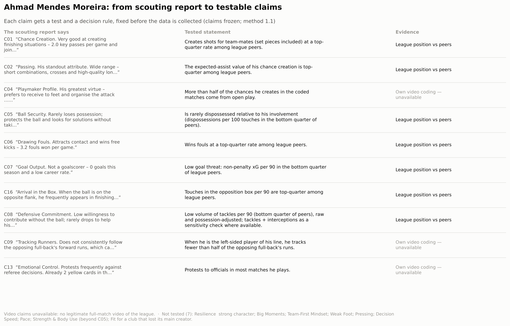
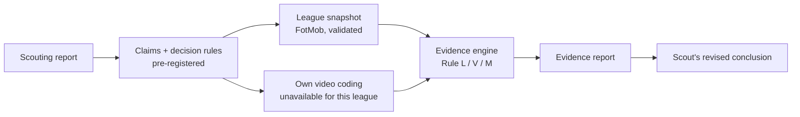

# Claim-to-Evidence Scouting

A scouting report makes claims — "very good at creating chances", "does not track runners",
"protests frequently". This project tests each claim against **league data** and the scout's
**own video coding**, with rules written down **before** the data is collected, and reports every
result: supported, partly supported, not supported, contradicted, inconclusive, insufficient or
unavailable.

It does not rate players, weight claims or recommend signings. The engine applies the rules; the
scouting conclusion stays with the scout.

> **Status:** claims and method pre-registered at the tag `prereg-v1.0` (2026-10-11); method 1.1
> changes how omitted FotMob rows are read (see `docs/DEVIATIONS.md`). Video
> evidence for the case study is closed: no legitimate full-match video of the league is available,
> so the three video claims are reported as unavailable (see `docs/DEVIATIONS.md`). No real data
> collected yet; the figures below come from synthetic data, where the video layer is shown.

## The case study: Ahmad Mendes Moreira

The scouting report ([PDF](players/mendes-moreira/original-report.pdf); written after watching three
matches live — the club-fit paragraph is a hypothetical scenario, not advice to a real club) turned
into claims, each with its test, before any data was collected (`uv run c2e map players/mendes-moreira --out map.png`):





## Demo (synthetic data, runs anywhere)

```bash
uv sync
uv run c2e run players/example --out reports/example/v2
```


Every player, team and match in `players/example/` is invented
(`scripts/make_synthetic.py`, fixed seed).

## How it works

```
player.yaml + claims.yaml + metrics.yaml          (configuration, validated with pydantic)
        │
league snapshot · teams · facts · cards · history (CSV, validated with pandera contracts)
tagging: matches · segments · events              (own video coding, TAGGING_PROTOCOL.md)
        │
per 90 / per 100 touches from season totals → peer group → rule per claim
        │
claims.csv · evidence-report.md · 4 figures
```

| Rule | Evidence | What a verdict means |
|---|---|---|
| **L** league position | Season totals vs peers of the same positions | Where the point estimate sits among peers (top quarter / above median / at or below). Ties count against the claim. Not a significance test. |
| **V** video proportion | Own coding, one opportunity per event | Wilson one-sided 95% bound and leave-one-match-out against a stated threshold |
| **M** match majority | Matches in which a behaviour was seen | Majority of coded matches, robust to removing one |

Every verdict also reports its pre-registered sensitivity analyses (stricter peer minutes,
possession adjustment, ambiguous video events); the final verdict is the weakest of them.
Details: [`docs/METHOD.md`](docs/METHOD.md).

## Repository

```
config/metrics.yaml        metric definitions (source label, unit, limitations)
docs/                      METHOD, TAGGING_PROTOCOL, DATA_SOURCES, DEVIATIONS
players/example/           fictional player + synthetic data (demo and golden test)
players/mendes-moreira/    real case study: configuration and claims only, no data
src/c2e/                   config · contracts · stats · metrics · tagging · evidence ·
                           descriptive · pipeline · viz · report · cli
tests/                     hand-worked cases, Hypothesis invariants, golden end-to-end test
```

Third-party data never enters git (`private/`, `data/raw/` are ignored, and a test checks that
only synthetic tables are committed).

## Add a player

1. Copy `players/example/` to `players/<id>/` and edit `player.yaml` and `claims.yaml`.
2. Put the snapshot CSVs in a private folder and the video coding in `players/<id>/tagging/`.
3. `uv run c2e validate players/<id> --data-dir <private folder> --snapshot <name>`
4. `uv run c2e run players/<id> --data-dir <private folder> --snapshot <name> --out <folder>`

No code changes are needed.

## Development

```bash
uv run ruff check . && uv run ruff format --check . && uv run mypy && uv run pytest
```

## Data and attribution

League statistics and match facts for the case study come from FotMob; the calendar from the
official league site (slgr.gr). Video coding was planned but is unavailable for this league.
See [`docs/DATA_SOURCES.md`](docs/DATA_SOURCES.md).

*Independent portfolio project. Not affiliated with any club; not a recruitment decision.*
