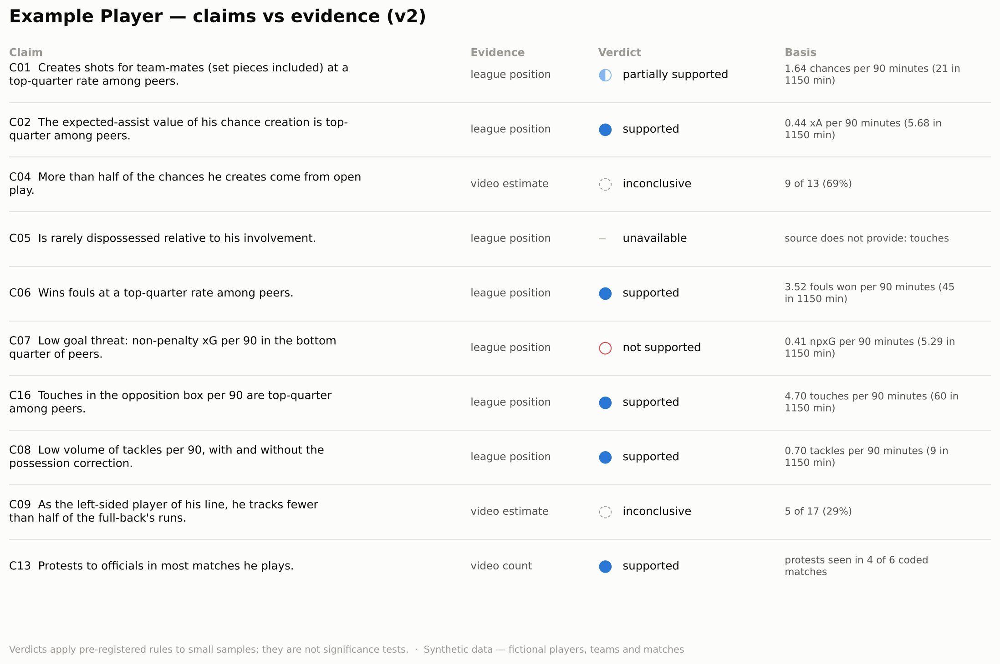
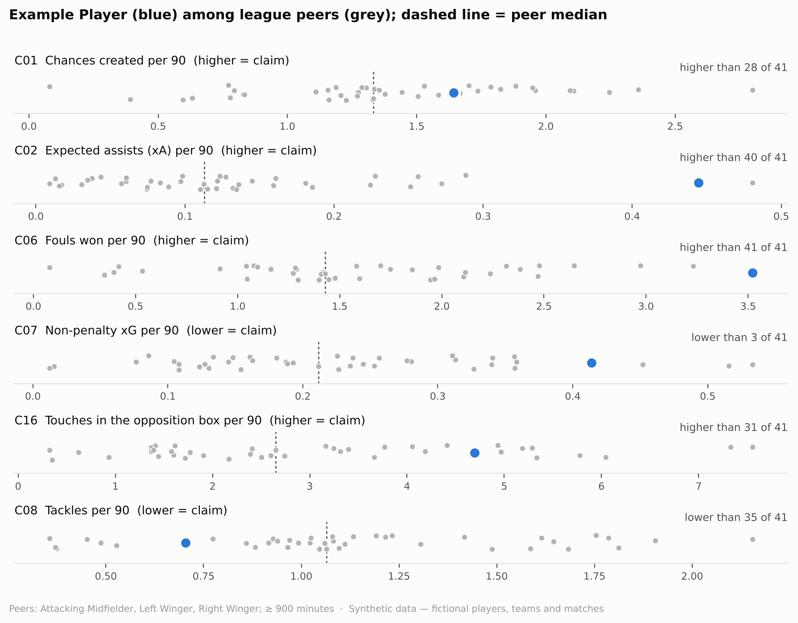
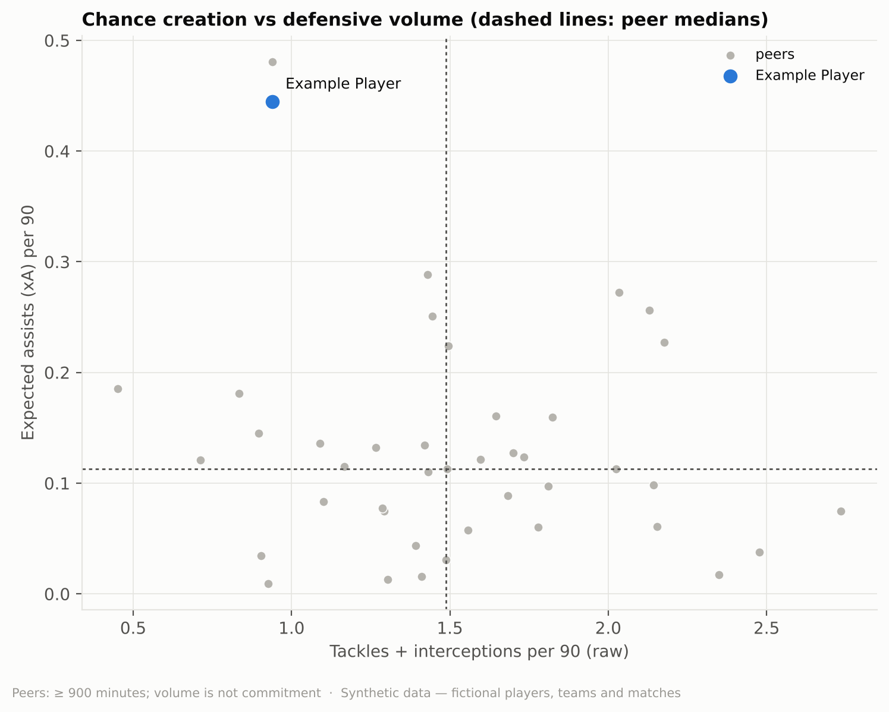
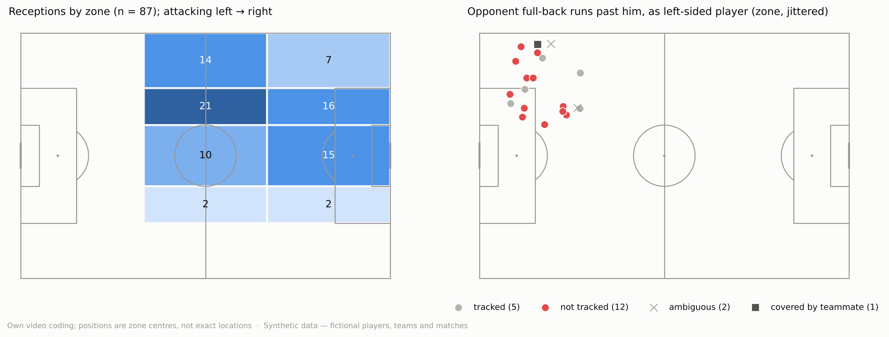

# Evidence report — Example Player

> **Synthetic demo.** Every player, team, match and number here is invented.

> Independent portfolio exercise. Not affiliated with any club and not a recruitment decision: the engine applies pre-registered rules; the scouting conclusion is written by the scout.

- **Snapshot:** `v2` — demo of the publication snapshot; last match 2030-11-30, collected 2030-12-21.
- **Claims file:** status `draft`, method 1.0-rc1.
- **Peers:** Attacking Midfielder, Left Winger, Right Winger; ≥ 900 minutes (strict variant ≥ 1080); at least 20 required.
- **Data:** Synthetic data — fictional players, teams and matches

## How to read this

League verdicts describe where the player's season value sits among peers (`league_position`); they are **not significance tests**. Video verdicts come from the scout's own coding of a few matches (`video_estimate`, `video_count`). `INSUFFICIENT_DATA` and `UNAVAILABLE` are results, not failures.

## Claims

| id | question | evidence_type | verdict | basis |
|---|---|---|---|---|
| C01 | Q1 | league_position | PARTIALLY_SUPPORTED | 1.64 chances per 90 minutes (21 in 1150 min); higher than 28 of 41 peers (0 tied): above the median, below the top quarter |
| C02 | Q1 | league_position | SUPPORTED | 0.44 xA per 90 minutes (5.68 in 1150 min); higher than 40 of 41 peers (0 tied): top quarter |
| C04 | Q2 | video_estimate | INCONCLUSIVE | 9 of 13 (69%); 90% Wilson 46%–85%; threshold 50%; 1 with unknown phase excluded |
| C05 | Q1 | league_position | UNAVAILABLE | source does not provide: touches |
| C06 | Q1 | league_position | SUPPORTED | 3.52 fouls won per 90 minutes (45 in 1150 min); higher than 41 of 41 peers (0 tied): top quarter |
| C07 | Q3 | league_position | NOT_SUPPORTED | 0.41 npxG per 90 minutes (5.29 in 1150 min); lower than 3 of 41 peers (0 tied): at or below the median |
| C16 | Q3 | league_position | SUPPORTED | 4.70 touches per 90 minutes (60 in 1150 min); higher than 31 of 41 peers (0 tied): top quarter |
| C08 | Q4 | league_position | SUPPORTED | 0.70 tackles per 90 minutes (9 in 1150 min); lower than 35 of 41 peers (0 tied): top quarter |
| C09 | Q4 | video_estimate | INCONCLUSIVE | 5 of 17 (29%); 90% Wilson 15%–49%; threshold 50%; sensitivity analyses disagree |
| C13 | Q7 | video_count | SUPPORTED | protests seen in 4 of 6 coded matches |

### C01 — partially supported

- **Report says:** "Very good at creating finishing situations."
- **Tested statement:** Creates shots for team-mates (set pieces included) at a top-quarter rate among peers.
- **Evidence type:** league_position
- **Rule:** `{"type":"league_position","metric":"chances_created_p90","direction":"high","possession_variant":false,"variant_metrics":[]}`
- **Result:** 1.64 chances per 90 minutes (21 in 1150 min); higher than 28 of 41 peers (0 tied): above the median, below the top quarter
- **Analyses (main + pre-registered sensitivity):**
  - main: PARTIALLY_SUPPORTED — higher than 28 of 41 peers (0 tied): above the median, below the top quarter
  - strict_minutes: PARTIALLY_SUPPORTED — higher than 16 of 26 peers (0 tied): above the median, below the top quarter
- **Limitations:** Includes set pieces which favours set-piece takers.

### C02 — supported

- **Report says:** "Chance creation is his standout quality."
- **Tested statement:** The expected-assist value of his chance creation is top-quarter among peers.
- **Evidence type:** league_position
- **Rule:** `{"type":"league_position","metric":"xa_p90","direction":"high","possession_variant":false,"variant_metrics":[]}`
- **Result:** 0.44 xA per 90 minutes (5.68 in 1150 min); higher than 40 of 41 peers (0 tied): top quarter
- **Analyses (main + pre-registered sensitivity):**
  - main: SUPPORTED — higher than 40 of 41 peers (0 tied): top quarter
  - strict_minutes: SUPPORTED — higher than 26 of 26 peers (0 tied): top quarter
- **Limitations:** Proprietary xA model.

### C04 — inconclusive

- **Report says:** "A playmaker, not just a set-piece taker."
- **Tested statement:** More than half of the chances he creates come from open play.
- **Evidence type:** video_estimate
- **Rule:** `{"type":"video_proportion","measure":"open_play_share","direction":"greater","threshold":0.5}`
- **Result:** 9 of 13 (69%); 90% Wilson 46%–85%; threshold 50%; 1 with unknown phase excluded
- **Analyses (main + pre-registered sensitivity):**
  - main: INCONCLUSIVE — 9 of 13 (69%); 90% Wilson 46%–85%; threshold 50%
- **By sample (descriptive):**
  - pre_report: INSUFFICIENT_DATA: 4 of 7 (< 10 events)
  - post_freeze: INSUFFICIENT_DATA: 5 of 6 (< 10 events)

### C05 — unavailable

- **Report says:** "Protects the ball well."
- **Tested statement:** Is rarely dispossessed relative to his involvement.
- **Evidence type:** league_position
- **Rule:** `{"type":"league_position","metric":"dispossessed_per100_touches","direction":"low","possession_variant":false,"variant_metrics":[]}`
- **Result:** source does not provide: touches
- **Limitations:** Does not count misplaced passes.

### C06 — supported

- **Report says:** "Draws a lot of fouls."
- **Tested statement:** Wins fouls at a top-quarter rate among peers.
- **Evidence type:** league_position
- **Rule:** `{"type":"league_position","metric":"fouls_won_p90","direction":"high","possession_variant":false,"variant_metrics":[]}`
- **Result:** 3.52 fouls won per 90 minutes (45 in 1150 min); higher than 41 of 41 peers (0 tied): top quarter
- **Analyses (main + pre-registered sensitivity):**
  - main: SUPPORTED — higher than 41 of 41 peers (0 tied): top quarter
  - strict_minutes: SUPPORTED — higher than 26 of 26 peers (0 tied): top quarter

### C07 — not supported

- **Report says:** "Not a goalscorer."
- **Tested statement:** Low goal threat: non-penalty xG per 90 in the bottom quarter of peers.
- **Evidence type:** league_position
- **Rule:** `{"type":"league_position","metric":"npxg_p90","direction":"low","possession_variant":false,"variant_metrics":[]}`
- **Result:** 0.41 npxG per 90 minutes (5.29 in 1150 min); lower than 3 of 41 peers (0 tied): at or below the median
- **Analyses (main + pre-registered sensitivity):**
  - main: NOT_SUPPORTED — lower than 3 of 41 peers (0 tied): at or below the median
  - strict_minutes: NOT_SUPPORTED — lower than 0 of 26 peers (0 tied): at or below the median

### C16 — supported

- **Report says:** "Often appears in finishing zones."
- **Tested statement:** Touches in the opposition box per 90 are top-quarter among peers.
- **Evidence type:** league_position
- **Rule:** `{"type":"league_position","metric":"touches_opp_box_p90","direction":"high","possession_variant":false,"variant_metrics":[]}`
- **Result:** 4.70 touches per 90 minutes (60 in 1150 min); higher than 31 of 41 peers (0 tied): top quarter
- **Analyses (main + pre-registered sensitivity):**
  - main: SUPPORTED — higher than 31 of 41 peers (0 tied): top quarter
  - strict_minutes: SUPPORTED — higher than 22 of 26 peers (0 tied): top quarter

### C08 — supported

- **Report says:** "Low defensive contribution."
- **Tested statement:** Low volume of tackles per 90, with and without the possession correction.
- **Evidence type:** league_position
- **Rule:** `{"type":"league_position","metric":"tackles_p90","direction":"low","possession_variant":true,"variant_metrics":["tackles_interceptions_p90"]}`
- **Result:** 0.70 tackles per 90 minutes (9 in 1150 min); lower than 35 of 41 peers (0 tied): top quarter
- **Analyses (main + pre-registered sensitivity):**
  - main: SUPPORTED — lower than 35 of 41 peers (0 tied): top quarter
  - strict_minutes: SUPPORTED — lower than 22 of 26 peers (0 tied): top quarter
  - possession_adjusted: SUPPORTED — lower than 30 of 36 peers (0 tied): top quarter
  - metric:tackles_interceptions_p90: SUPPORTED — lower than 35 of 41 peers (0 tied): top quarter
- **Limitations:** Volume not commitment; role confounds it.

### C09 — inconclusive

- **Report says:** "Does not track the opposing full-back."
- **Tested statement:** As the left-sided player of his line, he tracks fewer than half of the full-back's runs.
- **Evidence type:** video_estimate
- **Rule:** `{"type":"video_proportion","measure":"tracking_rate","direction":"less","threshold":0.5}`
- **Result:** 5 of 17 (29%); 90% Wilson 15%–49%; threshold 50%; sensitivity analyses disagree
- **Analyses (main + pre-registered sensitivity):**
  - main: SUPPORTED — 5 of 17 (29%); 90% Wilson 15%–49%; threshold 50%
  - ambiguous_as_tracked: INCONCLUSIVE — 7 of 19 (37%); 90% Wilson 21%–56%; threshold 50%
  - ambiguous_as_not_tracked: SUPPORTED — 5 of 19 (26%); 90% Wilson 13%–45%; threshold 50%
- **By sample (descriptive):**
  - pre_report: INSUFFICIENT_DATA: 2 of 6 (< 10 events)
  - post_freeze: INCONCLUSIVE: 3 of 11 (27%); 90% Wilson 11%–52%; threshold 50%

### C13 — supported

- **Report says:** "Protests often to the referee."
- **Tested statement:** Protests to officials in most matches he plays.
- **Evidence type:** video_count
- **Rule:** `{"type":"match_majority","measure":"protest_matches"}`
- **Result:** protests seen in 4 of 6 coded matches
- **Analyses (main + pre-registered sensitivity):**
  - main: SUPPORTED — protests seen in 4 of 6 coded matches
- **By sample (descriptive):**
  - pre_report: 2 of 3 matches
  - post_freeze: 2 of 3 matches

## League peers

## Creation vs defensive volume

## Video coding

## Descriptive context (no verdicts)

- **D1 — assists and xA:** 1 assists from 5.68 xA, season to date.
- **D3 — within his team:** 1 team-mate(s) with ≥ 900 min create more chances per 90 (6 players compared).
- **D4 — receptions:** 87 coded; 27 between the lines; 5 in behind (receptions, not runs).
- **D5 — availability:** 14 starts in 15 team matches; 1207 of 1350 possible minutes; 11 full matches; absences — suspended: 1.
- **Cards (facts; reasons are classifications):** yellow (dissent_confirmed): 1, yellow (foul): 1, yellow (unknown): 1.

**D2 — opponent full-back runs by his role**

| his_role | minutes | tracked | not_tracked | covered_by_teammate | ambiguous | untracked_to_cross_or_shot |
|---|---|---|---|---|---|---|
| wide_left | 442.0 | 5 | 12 | 1 | 2 | 11 |

**D6 — history, one row per season and competition (never pooled)**

| season | competition | team | minutes | chances_created_p90 | xa_p90 | npxg_p90 |
|---|---|---|---|---|---|---|
| 2026/27 | Synthetic League | Synthetic FC 09 | 1890 | 1.48 | unavailable | unavailable |
| 2027/28 | Synthetic League | Synthetic FC 09 | 2210 | 1.63 | 0.13 | 0.1 |
| 2028/29 | Other Synthetic League | Synthetic Club | 1540 | 1.29 | 0.12 | 0.11 |
| 2029/30 | Synthetic League 2 | Synthetic FC 05 | 2400 | unavailable | unavailable | unavailable |

## Not tested

- "Strong character." — Not observable with match data or coded video.
- C03 withdrawn before pre-registration — Demo of a claim withdrawn before pre-registration.
